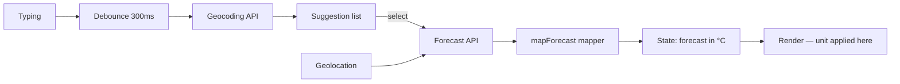

# Architecture — SkyLens Weather

**Shape:** three static files — `index.html`, `styles.css`, `app.js`. No build, no framework.

**Request flow (the core of the app):**

**Layers inside app.js:**
1. **API layer** — `fetchJson()` with per-flow AbortControllers (one for suggestions, one for forecasts).
2. **Mapper layer** — `mapPlace()` (geocoding result → place) and `mapForecast()` (zips hourly parallel arrays from the current hour, normalises daily arrays, keeps everything metric).
3. **State** — selected place, mapped forecast (°C only), display unit, last request (for retry).
4. **Render** — current card, hourly strip, daily list; unit conversion happens at render time.

**Caching:** the mapped forecast is held in memory (unit toggle + re-render are free); the last 5 selected places (name + coordinates) persist in localStorage, so a recent-city click skips geocoding entirely.
